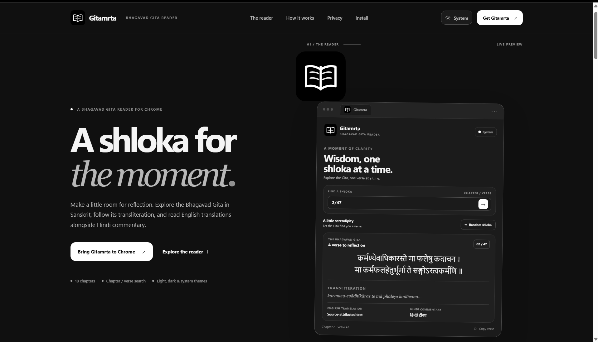

# Gitamrta


Gitamrta is a lightweight Chrome extension for reading the **Bhagavad Gita** one shloka at a time. It opens a verse for reflection, lets you look up a chapter and verse directly, and presents the Sanskrit text, Roman transliteration, English translation, and Hindi commentary when those fields are available from the scripture service.



The extension uses a quiet monochrome interface with System, Light, and Dark themes. It runs as a Manifest V3 browser popup and does not require an account.

> **License notice:** Gitamrta is proprietary, source-available software. Publicly viewable source code does not make it open source and does not grant general rights to copy, modify, redistribute, or commercially use it. Read [`license.txt`](license.txt) before using or contributing.

## Features

- **Random shloka:** Selects a random chapter first, then a valid verse within that chapter.
- **Chapter and verse search:** Enter a reference such as `2/47` or `18/78`.
- **Sanskrit text:** Displays the original verse returned by the scripture API.
- **Transliteration:** Displays the Roman transliteration when the API provides it.
- **English translation:** Displays the API's `et` field under **English Translation**.
- **Hindi commentary:** Displays the API's `hc` field under **Hindi Commentary**.
- **Author attribution:** Shows the author for supported translation/commentary entries.
- **Copy verse:** Copies the verse reference, Sanskrit, transliteration, and available translation/commentary text.
- **Three themes:** System, Light, and Dark. The selected theme is remembered.
- **Remember last verse:** Reopens the most recently viewed chapter and verse on the next popup launch.
- **Accessible interface details:** Visible keyboard focus, readable contrast, reduced-motion support, custom text-selection colors, and a slim theme-aware scrollbar.

Translation and commentary availability depends on the response returned by the external API. Gitamrta displays an availability message when the requested field is absent; it does not generate or supply missing translations or commentaries itself.

## Download the source

Gitamrta is **not currently distributed through the Chrome Web Store**. To obtain the project source, clone the repository once its repository URL has been published:

```bash
git clone https://github.com/darshseraphic/Gitamrta.git
cd <repository-directory>
```

## Add Gitamrta to Chrome

Gitamrta is loaded locally as an unpacked extension:

1. Clone the repository using the commands above.
2. Open `chrome://extensions` in Chrome.
3. Turn on **Developer mode** using the toggle on the Extensions page.
4. Select **Load unpacked**.
5. Choose the project directory that contains `manifest.json`.
6. Confirm that **Gitamrta** appears in the extensions list. Use Chrome's Extensions menu to pin it to the toolbar for easy access.
7. Open the Gitamrta toolbar icon to use the reader.

To update a local checkout after an authorized project update, pull the latest repository changes and use the Reload control for Gitamrta on `chrome://extensions`.

## How to use it

### Open a verse

- On the first launch, Gitamrta selects and loads a random chapter/verse pair.
- On later launches, it attempts to load the last verse you viewed.
- Select **Random shloka** to discover another verse.

### Search for a chapter and verse

1. Enter a reference in `chapter/verse` format. For example, `2/47` means Chapter 2, Verse 47.
2. Press Enter or select the arrow button.
3. Gitamrta checks that the chapter is between 1 and 18 and that the verse number is within the configured count for that chapter.

Spaces around the slash are accepted. Other formats are not accepted by the current search field.

### Change the appearance

Select the theme control in the top-right corner to cycle through **System → Light → Dark**. System follows the browser/operating-system color preference. The selected mode is stored locally.

### Copy a verse

Select **Copy verse** at the bottom of the verse card. The copied text includes the chapter/verse reference, Sanskrit, transliteration when available, and the available English translation and Hindi commentary entries with their author names. The button reports whether the copy operation succeeded.

## How it works

1. **Choose a reference.** The randomizer chooses one of the 18 chapters and then chooses a verse using the chapter verse-count list bundled in `popup.js`. A manual search is validated against the same list.
2. **Request the verse.** The popup sends an HTTPS `GET` request to the Vedic Scriptures endpoint:

   ```text
   https://vedicscriptures.github.io/slok/{chapter}/{verse}
   ```

3. **Read the response.** The popup reads the `chapter`, `verse`, `slok`, and `transliteration` fields. It also looks through the response's author objects for `et` (English translation) and `hc` (Hindi commentary).
4. **Filter attribution entries.** The current implementation displays entries attributed to Swami Adidevananda, Shri Purohit Swami, or A.C. Bhaktivedanta Swami Prabhupada. An entry is displayed only when its author and requested text field are present.
5. **Render the text.** API-provided content is inserted as text rather than interpreted as HTML. Missing translation/commentary fields are shown as unavailable.
6. **Remember preferences.** Chrome's local extension storage holds the selected theme and last viewed chapter/verse. Verse text is fetched again when the popup opens; the extension does not keep an offline verse library.

The API is an external service. Gitamrta requires an internet connection to retrieve verses, and availability or response changes at that service can affect the reader.

## Privacy and permissions

The current extension requests only the Chrome `storage` permission and host access to `https://vedicscriptures.github.io/*` for verse requests. It has no content scripts and does not request access to browsing history, tabs, cookies, or all websites.

The extension stores the theme choice and last chapter/verse locally through `chrome.storage.local`. When a verse is requested, the external scripture service receives the requested chapter/verse path and ordinary connection metadata. The copy button writes verse text to the clipboard only after the user selects it; Gitamrta does not read clipboard contents.

There is no analytics or advertising code in the current project source. For a fuller explanation and the limits of these statements, see [`security.md`](security.md).

## Project structure

| File or directory | Purpose |
|---|---|
| `manifest.json` | Chrome Manifest V3 metadata, popup entry point, icons, version, and requested permissions/host access. |
| `popup.html` | Popup document structure, labels, search form, verse sections, controls, and accessible element IDs. |
| `popup.css` | Layout, typography, monochrome color tokens, Light/Dark/System themes, selection and scrollbar styling, responsive states, and reduced-motion behavior. |
| `popup.js` | Search parsing and validation, random chapter/verse selection, API requests, response rendering, theme handling, local storage, retry, and copy behavior. |
| `icons/gitamrta-logo.svg` | Master Gitamrta logo used in the popup and as the source for the extension icons. |
| `icons/icon16.png` | 16 × 16 Chrome toolbar/list icon. |
| `icons/icon32.png` | 32 × 32 extension icon asset. |
| `icons/icon48.png` | 48 × 48 extension management icon. |
| `icons/icon128.png` | 128 × 128 large extension/store-style icon asset. |
| `DESIGN_CREDITS.md` | Attribution and license information for the credited design inspiration. |
| `license.txt` | Gitamrta proprietary source-available license. |
| `contributing.md` | Permitted contribution paths and the limits imposed by the license. |
| `security.md` | Permissions, network behavior, local data, and vulnerability reporting guidance. |
| `changelog.md` | Recorded project features and documentation changes. |
| `website/` | Responsive static landing page for Gitamrta, including its own README, styles, script, configuration, and shared logo asset. |

## Project website

A responsive static landing page is included in [`website/`](website/). To preview it locally, open [`website/index.html`](website/index.html) in a browser. No build step or package installation is required. The public repository URL is intentionally left blank in [`website/config.js`](website/config.js); add the official URL there when it is ready to publish. See [`website/README.md`](website/README.md) for configuration and deployment notes.

## Troubleshooting

- **A verse does not load:** Check your internet connection and retry. The external API may be unavailable or may return an error.
- **A verse reference is rejected:** Use `chapter/verse` and check that the verse number is valid for the selected chapter.
- **A translation or commentary is missing:** The API may not provide that field for the selected verse or a supported author. Gitamrta shows an unavailable message in that case.
- **The extension does not appear:** Confirm that you selected the project folder containing `manifest.json` in **Load unpacked**.
- **An update does not appear:** Reload Gitamrta from `chrome://extensions` after updating the local project files.

## Design and third-party notices

The interface adapts the monochrome design guidance supplied for this project. The supplied design reference identifies the Votrixain visual system and records design refinements guided by **Unslop** by Damir Sokolovsky. The applicable design attribution is documented in [`DESIGN_CREDITS.md`](DESIGN_CREDITS.md), which identifies the Unslop attribution as **Creative Commons Attribution 4.0 International (CC BY 4.0)**.

The scripture content is requested from the external Vedic Scriptures API at `vedicscriptures.github.io`. The API service is not bundled with Gitamrta and may have separate terms or availability policies. Chrome is the browser platform used to run the extension.

## Contributing and security

Please read [`contributing.md`](contributing.md) before proposing changes. The proprietary license allows limited source inspection, personal non-commercial use of official unmodified releases, and bug reports or suggestions; it does not grant general modification, fork, or redistribution rights.

For security concerns, follow [`security.md`](security.md) and contact the project owner using the address listed in `license.txt`.

## License

Copyright © 2026 Darshseraphic. All Rights Reserved. See [`license.txt`](license.txt) for the complete license terms. Design credits and third-party material remain subject to their separately identified terms.
